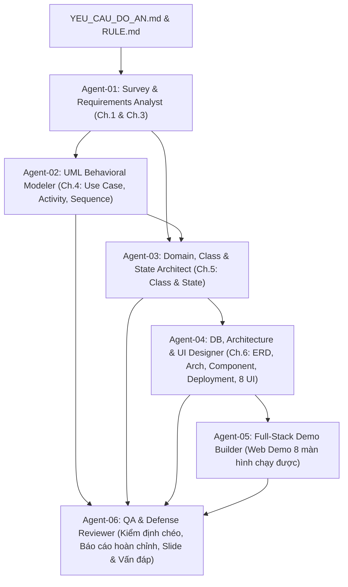

# KIẾN TRÚC & ĐỊNH NGHĨA HỆ THỐNG AI AGENTS (AGENTS.md)

> [!NOTE]
> Tệp này định nghĩa cấu trúc phân vai và giao thức phối hợp cho các **AI Agents** (hoặc các phiên làm việc chuyên biệt của AI) khi hỗ trợ 5 thành viên **Nhóm 8** hoàn thành toàn bộ hồ sơ **Đồ án 8: Hệ thống đặt phòng và quản lý khách sạn** từ ngày **21/11/2026** đến ngày **05/12/2026**.

---

## 1. SƠ ĐỒ PHỐI HỢP GIỮA CÁC AI AGENTS (MULTI-AGENT WORKFLOW)

---

## 2. ĐỊNH NGHĨA CHI TIẾT 6 VAI TRÒ AI AGENT

### Agent-01: `Survey & Requirements Analyst` (Chuyên gia Khảo sát & Kỹ nghệ Yêu cầu — Chương 1 & Chương 3)
- **Mục tiêu:** Soạn thảo hoàn chỉnh **Đề cương đồ án**, **Chương 1 (Tổng quan)**, **Chương 3 (Khảo sát hiện trạng và yêu cầu)** và **Phụ lục khảo sát**.
- **Nhiệm vụ cụ thể:**
  1. Giải thích lý do chọn quy trình phát triển **Lặp và Tăng trưởng (Iterative & Incremental / Unified Process)** cho hệ thống khách sạn quy mô vừa.
  2. Tổng hợp kết quả khảo sát thực tế từ **bản demo QloApps** (trang khách đặt phòng & trang quản trị back-office) kết hợp biên bản phỏng vấn lễ tân khách sạn.
  3. Lập bảng **Quy tắc nghiệp vụ (`BR-01` → `BR-12`)**: tỷ lệ đặt cọc, bậc phí hủy theo số ngày báo trước, phụ thu nhận phòng sớm (Early Check-in) – trả phòng muộn (Late Check-out), công thức giá theo mùa (`Season`) và cuối tuần (`RatePlan`), quy định pháp lý thông báo lưu trú (**trước 23:00**, khách đến sau 23:00 thì thông báo **trước 08:00 sáng hôm sau** theo Luật Cư trú sửa đổi).
  4. Viết danh sách **Yêu cầu chức năng** phân theo 8 tác nhân và **Yêu cầu phi chức năng** theo chuẩn ISO/IEC 25010 có số đo kiểm chứng được (đặc biệt là yêu cầu **không được bán trùng một phòng khi Website, OTA và Lễ tân cùng đặt**).
  5. Xây dựng **Bảng thuật ngữ (Glossary)** song ngữ Việt – Anh (`Booking`, `Stay`, `RoomType`, `Room`, `Folio`, `FolioCharge`, `DateRange`, `RatePlan`, `OTA`, `No-show`...).
- **Đầu ra bàn giao:** `docs/chuong_1_tong_quan.md`, `docs/chuong_3_khao_sat_yeu_cau.md`, `docs/phu_luc_khao_sat.md`.

---

### Agent-02: `UML Behavioral Modeler` (Chuyên gia Mô hình hóa Hành vi & Yêu cầu — Chương 4)
- **Mục tiêu:** Thiết kế toàn bộ sơ đồ và đặc tả của **Chương 4 (Mô hình hóa yêu cầu)** bằng mã nguồn **PlantUML (`uml/ch4_*.puml`)** và văn bản đặc tả chuẩn Larman.
- **Nhiệm vụ cụ thể:**
  1. **Sơ đồ Use Case Tổng quát & 5 Sơ đồ Phân rã theo 5 cụm thành viên:**
     - Thể hiện đủ 8 tác nhân (có Tổng quát hóa `Khách` $\leftarrow$ `Khách lẻ`, `Khách đoàn`).
     - Thể hiện chính xác 3 quan hệ bắt buộc:
       - `<<include>>`: `“Kiểm tra phòng trống”` trong `“Đặt phòng”` và `“Đổi phòng”`.
       - `<<extend>>`: `“Áp dụng mã khuyến mãi”` vào `“Đặt phòng”`.
       - **Tổng quát hóa:** `“Thanh toán”` $\leftarrow$ `“Thanh toán thẻ”`, `“Chuyển khoản”`, `“Tiền mặt”`.
     - Viết lập luận giải thích cho từng quan hệ vì sao không chọn quan hệ khác.
  2. **Đặc tả chi tiết (Fully Dressed) cho 10 Use Case chính** (vượt mức tối thiểu $\ge 6$ của đề):
     - `UC-01`: Tìm phòng trống và Đặt phòng trực tuyến có đặt cọc (Thành).
     - `UC-02`: Sửa / Hủy đặt phòng và tính phí hủy (Thành).
     - `UC-03`: Nhận phòng (Check-in), gán phòng cụ thể và gửi thông báo lưu trú (Cường).
     - `UC-04`: Đổi phòng trong thời gian lưu trú (Cường).
     - `UC-05`: Ghi nhận dịch vụ phát sinh vào Folio (Tâm).
     - `UC-06`: Trả phòng (Check-out), thanh toán và xuất hóa đơn (Tâm).
     - `UC-07`: Quản lý và cập nhật tình trạng buồng phòng / bảo trì (Quân).
     - `UC-08`: Quản lý hồ sơ khách lưu trú & lịch sử lưu trú (Quân).
     - `UC-09`: Cấu hình giá theo mùa và cuối tuần (Kiệt).
     - `UC-10`: Xem báo cáo công suất phòng và doanh thu (Kiệt).
  3. **4 Sơ đồ Hoạt động (Activity Diagrams — tối thiểu $\ge 3$):**
     - `AD-01` *(Trọng tâm đề tài 8)*: Quy trình xuyên suốt từ **Nhận phòng đến Trả phòng** với 4 làn (Swimlanes): `Khách – Lễ tân – Buồng phòng – Kế toán`.
     - `AD-02`: Quy trình Đặt phòng trực tuyến, áp mã khuyến mãi và thanh toán đặt cọc.
     - `AD-03`: Quy trình Đổi phòng và cập nhật buồng phòng.
     - `AD-04`: Quy trình Dọn buồng và xử lý Bảo trì phòng.
  4. **6 Sơ đồ Tuần tự (Sequence Diagrams — tối thiểu $\ge 5$):**
     - `SD-01` *(Bắt buộc)*: Đặt phòng trực tuyến có đặt cọc.
     - `SD-02` *(Bắt buộc)*: Nhận phòng (gán phòng cụ thể, gửi thông báo lưu trú qua Adapter công an).
     - `SD-03` *(Bắt buộc)*: Trả phòng (tổng hợp chi phí `Folio`, thanh toán và giải phóng buồng).
     - `SD-04`: Đổi phòng (gọi `Kiểm tra phòng trống`, chuyển phòng và cập nhật `Stay`).
     - `SD-05`: Ghi dịch vụ phát sinh (Minibar/Giặt là/Nhà hàng) vào `Folio`.
     - `SD-06`: Hủy đặt phòng / Xử lý quá hạn giữ phòng (`No-show`).
- **Đầu ra bàn giao:** `uml/ch4_*.puml`, `docs/chuong_4_mo_hinh_hoa_yeu_cau.md`.

---

### Agent-03: `Domain, Class & State Architect` (Chuyên gia Phân tích Lớp & Trạng thái — Chương 5)
- **Mục tiêu:** Xây dựng toàn bộ mô hình tĩnh và động của **Chương 5 (Phân tích)**.
- **Nhiệm vụ cụ thể:**
  1. **Sơ đồ Lớp Mức Phân tích (Analysis Class Diagram) & Mức Thiết kế (Design Class Diagram):**
     - Bao gồm đầy đủ các lớp: `RoomType`, `Room`, `Booking`, `Stay`, `DateRange`, `Guest`, `Folio`, `FolioCharge`, `Service`, `RatePlan`, `Season`, `Payment` (`CardPayment`, `BankTransferPayment`, `CashPayment`), `PromotionCode`.
     - Mô tả chi tiết thuộc tính, kiểu dữ liệu, phạm vi truy cập (`-`, `+`, `#`), phương thức nghiệp vụ, bội số (`1`, `0..*`, `1..*`) và quan hệ (Association, Aggregation, Composition `Folio *-- FolioCharge`, Generalization).
     - Trình bày bài thảo luận chuyên sâu: **Lớp nào chịu trách nhiệm `isAvailable(range: DateRange)` và vì sao** dựa trên nguyên tắc **GRASP Information Expert, Creator, Low Coupling, High Cohesion**.
  2. **2 Sơ đồ Trạng thái Độc lập (State Machine Diagrams — Trọng tâm đề tài 8):**
     - `SMD-01` — Trạng thái của **`Room`**: `Trống sạch → Có khách → Trống bẩn → Đang dọn → Trống sạch`, cùng nhánh `Bảo trì`.
     - `SMD-02` — Trạng thái của **`Booking`**: `Tạm giữ → Đã xác nhận → Đã nhận phòng → Đã trả phòng`, cùng các nhánh `Đã hủy`, `Không đến`; biểu diễn rõ sự kiện thời gian *“hết giờ giữ phòng của ngày đến mà khách chưa nhận phòng”*.
- **Đầu ra bàn giao:** `uml/ch5_*.puml`, `docs/chuong_5_phan_tich.md`.

---

### Agent-04: `Database, System Architect & UI Designer` (Chuyên gia Thiết kế Hệ thống, CSDL & Giao diện — Chương 6)
- **Mục tiêu:** Hoàn thiện toàn bộ nội dung **Chương 6 (Thiết kế)**.
- **Nhiệm vụ cụ thể:**
  1. **Thiết kế Dữ liệu (CSDL Quan hệ):**
     - Vẽ Lược đồ CSDL quan hệ (ERD / Relational Schema) chuyển đổi chuẩn xác từ Sơ đồ lớp (theo phương pháp Scott Ambler).
     - Viết truy vấn SQL tìm phòng trống bằng điều kiện chồng lấn khoảng ngày $[a_1, b_1)$ và $[a_2, b_2)$: `a1 < b2 AND a2 < b1`.
     - Thiết kế cơ chế khóa (`SELECT ... FOR UPDATE`) và ràng buộc (`Exclusion Constraint` / Trigger) chống bán trùng phòng giữa Website, OTA và Lễ tân.
  2. **Thiết kế Kiến trúc, Thành phần, Cộng tác & Triển khai:**
     - **Sơ đồ Kiến trúc tổng thể:** Kiến trúc phân tầng (Presentation – Application/Domain – Infrastructure/Integration).
     - **Sơ đồ Thành phần (Component Diagram):** Thể hiện rõ các module nghiệp vụ và **2 bộ Adapter** (`OtaChannelAdapter` cho kênh OTA và `PoliceResidenceAdapter` cho Hệ thống thông báo lưu trú của cơ quan công an).
     - **2 Sơ đồ Cộng tác (Communication Diagrams):** Cộng tác đối tượng cho *Đặt phòng có đặt cọc* và *Nhận phòng & gửi thông báo lưu trú*.
     - **Sơ đồ Triển khai (Deployment Diagram):** Gồm các nút `Website đặt phòng`, `Phần mềm quầy lễ tân`, `Máy chủ ứng dụng & Máy chủ CSDL`, kết nối qua HTTPS/REST API tới `Cổng thanh toán`, `Kênh OTA`, `Cổng thông báo lưu trú Bộ Công an`.
  3. **Thiết kế 8 Màn hình Giao diện (UI Design) & Đánh giá Usability:**
     - Thiết kế đặc tả giao diện cho đúng 8 màn hình (đặc biệt là **Màn hình sơ đồ phòng theo ngày cho lễ tân**) và bảng tự đánh giá theo **10 Usability Heuristics của Nielsen Norman Group**.
- **Đầu ra bàn giao:** `uml/ch6_*.puml`, `docs/chuong_6_thiet_ke.md`.

---

### Agent-05: `Full-Stack Demo Builder` (Chuyên gia Xây dựng Bản Web Demo Cộng điểm)
- **Mục tiêu:** Hiện thực hóa bản **Web Demo chạy được** trong thư mục `demo-web/` để nhóm trình diễn trực tiếp khi bảo vệ và xuất ảnh chụp 8 màn hình giao diện thực tế chèn vào Chương 6.
- **Nhiệm vụ cụ thể:**
  1. Xây dựng giao diện Web tương tác đầy đủ 8 màn hình:
     - Đặt phòng trực tuyến theo `DateRange` (kiểm tra trùng lịch $a_1 < b_2 \land a_2 < b_1$, áp mã khuyến mãi, đặt cọc).
     - **Sơ đồ phòng theo ngày cho lễ tân (Interactive Room Rack Calendar)** hiển thị trực quan trạng thái từng phòng (`101`..`405`) theo từng ngày.
     - Nhận phòng (Check-in: gán phòng cụ thể + gửi thông báo lưu trú Công an với đồng hồ kiểm tra hạn 23:00 / 08:00).
     - Đổi phòng & Ghi dịch vụ phát sinh (Minibar, Giặt là, Nhà hàng) vào `Folio`.
     - Trả phòng (Check-out), tính tổng tiền theo mùa/cuối tuần, chọn 1 trong 3 phương thức thanh toán (Thẻ / Chuyển khoản / Tiền mặt) và in hóa đơn.
     - Bảng điều khiển Buồng phòng (`Trống bẩn → Đang dọn → Trống sạch / Bảo trì`).
     - Quản lý giá theo mùa (`Season`, `RatePlan`) & Báo cáo công suất phòng.
  2. Đảm bảo chạy mượt 100% offline/local trên trình duyệt khi nhóm mang laptop lên bảo vệ.
- **Đầu ra bàn giao:** `demo-web/` (mã nguồn đầy đủ + hướng dẫn chạy 1 click).

---

### Agent-06: `QA & Defense Reviewer` (Chuyên gia Kiểm định Chất lượng, Đóng gói Báo cáo & Huấn luyện Bảo vệ)
- **Mục tiêu:** Đảm bảo hồ sơ nộp đạt điểm tuyệt đối (9.5 – 10), không có bất kỳ mâu thuẫn nào giữa các chương.
- **Nhiệm vụ cụ thể:**
  1. **Kiểm tra chéo (Cross-Check Audit):** Đối chiếu toàn bộ báo cáo với Checklist tại Phần 6 của `YEU_CAU_DO_AN.md` và `RULE.md`.
  2. **Hợp nhất Báo cáo & Xuất Word (`.docx`):** Ghép nối các chương + Kết luận & Bảng phân công tự đánh giá nhóm (CLO6) + Phụ lục thành file Báo cáo cuối kỳ hoàn chỉnh, xuất sang `.docx` bằng Pandoc.
  3. **Soạn Slide Bảo vệ & Cẩm nang Vấn đáp cho 5 thành viên:** Soạn bộ Slide bảo vệ cô đọng và bộ câu hỏi – đáp án bảo vệ riêng cho từng thành viên theo đúng cụm Use Case mà thành viên đó phụ trách.

---

## 3. CÁCH GỌI AI AGENT CHO TỪNG THÀNH VIÊN TRONG NHÓM

Khi một trong 5 thành viên (**Thành, Cường, Tâm, Quân, Kiệt**) mở workspace này trong AI IDE, chỉ cần ra lệnh theo mẫu ngắn gọn sau:

- **Ví dụ 1 (Làm phần việc theo ngày trong PLAN):**
  > *"Đọc `INSTRUCTION.md`, `RULE.md` và `PLAN.md`. Đóng vai `Agent-02`, thực hiện toàn bộ nhiệm vụ của Cụm 2 (Nguyễn Trí Cường) trong Chương 4 gồm sơ đồ Use Case phân rã cụm Lễ tân, đặc tả đầy đủ UC-03 (Nhận phòng) và UC-04 (Đổi phòng), cùng Sequence Diagram SD-02 và SD-04 bằng PlantUML."*
- **Ví dụ 2 (Làm Web Demo & Giao diện Chương 6):**
  > *"Đọc `INSTRUCTION.md` và `RULE.md`. Đóng vai `Agent-05`, xây dựng bản Web Demo chạy được tại thư mục `demo-web/` có đầy đủ 8 màn hình giao diện của khách sạn, đặc biệt là Màn hình sơ đồ phòng theo ngày cho lễ tân và thuật toán kiểm tra chồng lấn `DateRange`."*
