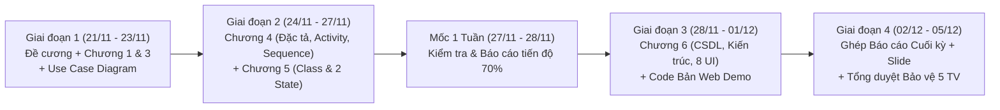

# KẾ HOẠCH CHI TIẾT TỪ A–Z (ZERO TO FINAL SUBMISSION) — ĐỒ ÁN NHÓM 8 (21/11/2026 – 05/12/2026)

> [!IMPORTANT]
> - **Đề tài:** Đồ án 8 — **Hệ thống đặt phòng và quản lý khách sạn**
> - **Học phần:** Phân tích thiết kế hướng đối tượng (`841111`) — Lớp Chiều Thứ 6 — Trường Đại học Sài Gòn (SGU)
> - **Thời gian thực hiện:** **14 ngày** — Bắt đầu từ **Thứ Bảy, 21/11/2026** đến **Thứ Sáu/Thứ Bảy, 04–05/12/2026**
> - **Mục tiêu đầu ra (Full Deliverables + Bonus):**
>   1. Đề cương đồ án + Báo cáo tiến độ + Báo cáo cuối kỳ hoàn chỉnh (Chương 1, 3, 4, 5, 6, Kết luận CLO6, Phụ lục).
>   2. Trọn bộ tệp mô hình UML gốc (`PlantUML .puml` + `draw.io .drawio`) & hình ảnh xuất chất lượng cao.
>   3. Bản thiết kế **8 màn hình giao diện** + **Bản Web Demo chạy được (`demo-web/`)** để lấy trọn điểm cộng.
>   4. Slide bảo vệ + Bộ câu hỏi & kịch bản trả lời bảo vệ cho cả 5 thành viên.

---

## 1. BẢNG PHÂN CÔNG 5 CỤM USE CASE CHO 5 THÀNH VIÊN (XUYÊN SUỐT TỪ ĐẶC TẢ ĐẾN THIẾT KẾ & DEMO)

Theo đúng quy định bắt buộc tại Trang 1 của đề cương: *"Mỗi thành viên phụ trách ít nhất một cụm use case từ đặc tả đến thiết kế, ghi rõ trong bảng phân công"*, công việc được chia thành **5 cụm nghiệp vụ độc lập nhưng khớp nối chặt chẽ**:

| Thành viên (MSSV) | Cụm Use Case Phụ trách | Phần việc Chương 1 & 3 (Khảo sát & Yêu cầu) | Phần việc Chương 4 (Use Case, Activity, Sequence) | Phần việc Chương 5 (Class & State Diagram) | Phần việc Chương 6 (CSDL, Kiến trúc, UI & Web Demo) |
| :--- | :--- | :--- | :--- | :--- | :--- |
| **1. Đặng Phú Thành** (`3124411275`) | **Cụm 1: Tìm kiếm, Đặt phòng trực tuyến/OTA, Khuyến mãi & Đặt cọc** | - Chương 1: Bài toán, mục tiêu, phạm vi. - Chương 3: Khảo sát trang đặt phòng QloApps; Quy tắc đặt cọc, mã khuyến mãi & phí hủy theo số ngày báo trước. | - Sơ đồ UC phân rã Cụm 1 (có `<<include>>` *Kiểm tra phòng trống* & `<<extend>>` *Áp dụng mã khuyến mãi*). - Đặc tả `UC-01` (Tìm & Đặt phòng trực tuyến có đặt cọc), `UC-02` (Sửa/Hủy đặt phòng). - Activity `AD-02` (Đặt phòng & đặt cọc). - Sequence `SD-01` (Đặt phòng trực tuyến có đặt cọc), `SD-06` (Hủy đặt phòng / No-show). | - Nhóm lớp: `RoomType`, `DateRange` (`includes()`, `overlaps()`), `Booking`, `PromotionCode`. - Thảo luận trách nhiệm `isAvailable(range)` ở mức `RoomType`. | - Bảng CSDL: `room_types`, `bookings`, `promotions` + Truy vấn SQL chống chồng lấn $[a_1, b_1) \cap [a_2, b_2)$ & khóa chống bán trùng. - Cộng tác `CD-01` (Đặt phòng có đặt cọc). - **UI & Demo (Màn 1 & 2):** Màn hình Tìm phòng trống theo ngày & Màn hình Đặt phòng/Áp mã khuyến mãi/Đặt cọc. |
| **2. Nguyễn Trí Cường** (`3124411049`) | **Cụm 2: Nghiệp vụ Lễ tân — Nhận phòng (Check-in), Đổi phòng & Thông báo lưu trú** | - Chương 1: Lựa chọn quy trình phát triển Lặp & Tăng trưởng và lý do. - Chương 3: Phỏng vấn lễ tân; Quy định pháp lý **Thông báo lưu trú** (trước 23h00 / sau 23h00 thì trước 08h00 sáng hôm sau); Yêu cầu phi chức năng chống bán trùng (Web, OTA, Lễ tân). | - Sơ đồ UC tổng quát toàn hệ thống + UC phân rã Cụm 2 (có `<<include>>` *Kiểm tra phòng trống* trong *Đổi phòng*). - Đặc tả `UC-03` (Nhận phòng, gán phòng cụ thể & gửi thông báo lưu trú), `UC-04` (Đổi phòng). - Activity `AD-01` *(Trọng tâm)*: 4 làn `Khách – Lễ tân – Buồng phòng – Kế toán` từ nhận phòng đến trả phòng. - Sequence `SD-02` *(Bắt buộc)*: Nhận phòng (gán phòng, gửi thông báo lưu trú) & `SD-04` (Đổi phòng). | - Nhóm lớp: `Stay`, `Room` (liên kết `Booking` giữ `RoomType` vs `Stay` gán `Room`). - **State Diagram 2 (`SMD-02`):** Sơ đồ trạng thái của **`Booking`** (`Tạm giữ → Đã xác nhận → Đã nhận phòng → Đã trả phòng` + nhánh `Đã hủy`, `Không đến` & sự kiện thời gian hết giờ giữ phòng). | - Bảng CSDL: `stays`, `stay_guests`, `residence_declarations` + Exclusion Constraint. - Thiết kế **Adapter** cho **OTA** (`OtaChannelAdapter`) và **Hệ thống thông báo lưu trú Công an** (`PoliceResidenceAdapter`). - Cộng tác `CD-02` (Nhận phòng & thông báo lưu trú). - **UI & Demo (Màn 3 & 4):** **Màn hình sơ đồ phòng theo ngày cho lễ tân (Room Rack)** & Màn hình Check-in/Đổi phòng/Khai báo lưu trú. |
| **3. Võ Huỳnh Thanh Tâm** (`3124411267`) | **Cụm 3: Dịch vụ phát sinh, Trả phòng (Check-out), Thanh toán & Hóa đơn** | - Chương 3: Thu thập bảng giá dịch vụ phụ trợ (Minibar, giặt là, nhà hàng); Quy tắc phụ thu nhận phòng sớm – trả phòng muộn; Bảng thuật ngữ (Glossary). | - Sơ đồ UC phân rã Cụm 3 (có **Tổng quát hóa** *Thanh toán* $\leftarrow$ *Thanh toán thẻ*, *Chuyển khoản*, *Tiền mặt* kèm câu giải thích). - Đặc tả `UC-05` (Ghi dịch vụ phát sinh), `UC-06` (Trả phòng, thanh toán & xuất hóa đơn). - Activity `AD-03` (Ghi dịch vụ & Tất toán trả phòng). - Sequence `SD-03` *(Bắt buộc)*: Trả phòng (tổng hợp chi phí) & `SD-05` (Ghi dịch vụ phát sinh). | - Nhóm lớp: `Folio`, `FolioCharge` (Composition với `Folio`), `Service`, `Payment` (`CardPayment`, `BankTransferPayment`, `CashPayment`), `Invoice`. - Giải thích nguyên tắc GRASP Creator & Information Expert khi tính tổng tiền `Folio`. | - Bảng CSDL: `folios`, `folio_charges`, `services`, `payments`, `invoices`. - **UI & Demo (Màn 5 & 6):** Màn hình Ghi dịch vụ phát sinh vào Folio & Màn hình Trả phòng (Check-out)/Thanh toán đa phương thức/Xuất hóa đơn. |
| **4. Nguyễn Hoài Quân** | **Cụm 4: Quản lý Buồng phòng (Housekeeping), Bảo trì & Hồ sơ Khách lưu trú** | - Chương 3: Khảo sát quy trình dọn buồng/bảo trì trên QloApps và thu thập thông tin CCCD/Passport khách lưu trú; Phụ lục biên bản phỏng vấn & phiếu khảo sát. | - Sơ đồ UC phân rã Cụm 4. - Đặc tả `UC-07` (Quản lý & cập nhật tình trạng buồng phòng/bảo trì), `UC-08` (Quản lý hồ sơ khách lưu trú & lịch sử lưu trú). - Activity `AD-04` (Quy trình dọn buồng & xử lý bảo trì phòng). | - Nhóm lớp: `Guest`, `Room` (chi tiết thuộc tính & trạng thái buồng). - **State Diagram 1 (`SMD-01`):** Sơ đồ trạng thái của **`Room`** (`Trống sạch → Có khách → Trống bẩn → Đang dọn → Trống sạch` + nhánh `Bảo trì`). | - Bảng CSDL: `rooms`, `housekeeping_logs`, `guests`. - **UI & Demo (Màn 7):** Màn hình Quản lý tình trạng buồng phòng (Housekeeping Board) & tra cứu khách lưu trú. |
| **5. Lê Anh Kiệt** (`3124411142`) | **Cụm 5: Giá theo mùa, Báo cáo Công suất & Kiến trúc/Triển khai Hệ thống** | - Chương 3: Khảo sát trang quản trị QloApps; Quy tắc tính giá theo mùa (`Season`) và cuối tuần (`RatePlan`); Danh mục tài liệu tham khảo. | - Sơ đồ UC phân rã Cụm 5. - Đặc tả `UC-09` (Cấu hình giá theo mùa & cuối tuần), `UC-10` (Xem báo cáo công suất phòng & doanh thu). | - Nhóm lớp: `RatePlan`, `Season`, và ghép nối hoàn chỉnh Sơ đồ lớp tổng thể (Phân tích & Thiết kế). | - Bảng CSDL: `rate_plans`, `seasons`. - **Sơ đồ Kiến trúc tổng thể**, **Sơ đồ Thành phần (Component)** và **Sơ đồ Triển khai (Deployment)** (*Website đặt phòng, Phần mềm quầy, Máy chủ CSDL*). - Đánh giá 10 Usability Heuristics (NN/g). - **UI & Demo (Màn 8):** Màn hình Cấu hình giá theo mùa & Báo cáo công suất phòng. |

---

## 2. LỘ TRÌNH THỰC HIỆN CHI TIẾT TỪNG NGÀY (14 NGÀY: 21/11/2026 – 05/12/2026)

---

### GIAI ĐOẠN 1 (NGÀY 1 – NGÀY 3 | 21/11/2026 – 23/11/2026): KHỞI ĐỘNG, KHẢO SÁT & CHỐT ĐỀ CƯƠNG + CHƯƠNG 1, CHƯƠNG 3

#### Ngày 1 — Thứ Bảy, 21/11/2026: Thống nhất quy chuẩn & Khảo sát thực tế
- **Toàn nhóm (30 phút họp đầu ngày):**
  - Đọc kỹ `YEU_CAU_DO_AN.md`, `RULE.md` và xác nhận 5 cụm Use Case trong `PLAN.md`.
  - Khởi tạo cấu trúc thư mục dự án: `docs/`, `uml/`, `ui-mockups/`, `demo-web/`.
- **Thành & Kiệt:**
  - Truy cập [bản demo QloApps](https://demo.qloapps.com/) (cả giao diện khách đặt phòng Front-Office và trang quản trị Back-Office), chụp lại màn hình quy trình tìm phòng theo khoảng ngày, giỏ phòng, cấu hình loại phòng (`Room Type`), giá theo mùa và quản lý trạng thái phòng.
- **Cường, Tâm & Quân:**
  - Thực hiện phỏng vấn (hoặc tổng hợp biên bản phỏng vấn thực tế) lễ tân và nhân viên buồng phòng khách sạn/homestay quy mô vừa (20–50 phòng): thu thập bảng giá, giờ nhận phòng (14:00) – trả phòng (12:00), quy định phụ thu nhận sớm/trả muộn (30%–50%–100%), chính sách đặt cọc (30%–50%), phí hủy phòng, quy trình dọn buồng/bảo trì và quy trình khai báo lưu trú trực tuyến trước 23:00 / 08:00 sáng hôm sau.
- **Sản phẩm cuối Ngày 1:** Tư liệu khảo sát QloApps + Biên bản phỏng vấn lễ tân & buồng phòng (`docs/phu_luc_khao_sat.md`).

#### Ngày 2 — Chủ Nhật, 22/11/2026: Hoàn thành Đề cương đồ án, Chương 1 & Chương 3
- **Thành:** Viết **Chương 1 (Mục 1.1 – 1.3)**: Bối cảnh bài toán khách sạn quy mô vừa, mục tiêu hệ thống, phạm vi đề tài (8 tác nhân, các chức năng trong và ngoài phạm vi) và bảng quy tắc đặt cọc/hủy phòng.
- **Cường:** Viết **Chương 1 (Mục 1.4)**: Lựa chọn quy trình phát triển phần mềm (Mô hình Lặp và Tăng trưởng / Unified Process qua 3 vòng lặp) và giải thích lý do; Viết phần quy định pháp lý **Thông báo lưu trú** (Luật Cư trú sửa đổi) và yêu cầu phi chức năng cốt lõi **Không bán trùng phòng (Zero Double-Booking)**.
- **Tâm:** Viết **Chương 3**: Tổng hợp danh sách **Yêu cầu chức năng** theo từng tác nhân, **Yêu cầu phi chức năng** theo chuẩn ISO/IEC 25010 (Hiệu năng, Độ tin cậy, Bảo mật, Khả dụng — tất cả đều có số đo định lượng kiểm chứng được) và **Bảng thuật ngữ (Glossary)**.
- **Quân:** Hoàn thiện **Phụ lục khảo sát** (biên bản phỏng vấn, phiếu khảo sát khách hàng/nhân viên) và quy trình nghiệp vụ buồng phòng trong Chương 3.
- **Kiệt:** Viết phần tổng hợp kết quả khảo sát hiện trạng & QloApps trong **Chương 3**, bảng quy tắc giá theo mùa/cuối tuần và đóng gói file **Đề cương đồ án (`docs/01_De_Cuong_Do_An.md`)**.
- **Sản phẩm cuối Ngày 2:** Hoàn tất 100% `docs/01_De_Cuong_Do_An.md`, `docs/chuong_1_tong_quan.md`, `docs/chuong_3_khao_sat_yeu_cau.md`.

#### Ngày 3 — Thứ Hai, 23/11/2026: Thiết kế Sơ đồ Use Case Tổng quát, Phân rã & Lập luận 3 Quan hệ (Chương 4 - Phần 1)
- **Cường:** Vẽ **Sơ đồ Use Case Tổng quát** (`uml/ch4_uc_tong_quat.puml`) bao gồm đủ 8 tác nhân (có Tổng quát hóa `Khách` $\leftarrow$ `Khách lẻ`, `Khách đoàn`), ranh giới hệ thống và đầy đủ 3 quan hệ bắt buộc:
  1. `<<include>>`: `“Kiểm tra phòng trống”` trong `“Đặt phòng”` và `“Đổi phòng”`.
  2. `<<extend>>`: `“Áp dụng mã khuyến mãi”` vào `“Đặt phòng”`.
  3. **Tổng quát hóa:** `“Thanh toán”` $\leftarrow$ `“Thanh toán thẻ”`, `“Chuyển khoản”`, `“Tiền mặt”`.
- **Thành, Cường, Tâm, Quân, Kiệt:** Mỗi người vẽ **1 Sơ đồ Use Case Phân rã** cho cụm của mình (`uml/ch4_uc_cum_1.puml` → `cum_5.puml`) và viết đoạn lập luận giải thích rõ vì sao chọn từng quan hệ mà không chọn quan hệ khác.
- **Sản phẩm cuối Ngày 3:** 6 tệp PlantUML Use Case Diagram + phần đầu Chương 4.

---

### GIAI ĐOẠN 2 (NGÀY 4 – NGÀY 7 | 24/11/2026 – 27/11/2026): HOÀN THÀNH CHƯƠNG 4, CHƯƠNG 5 & MỐC KIỂM TRA 1 TUẦN

#### Ngày 4 — Thứ Ba, 24/11/2026: Đặc tả 10 Use Case chính & Vẽ 4 Sơ đồ Hoạt động (Chương 4 - Phần 2)
- **Đặc tả Use Case dạng đầy đủ (Fully Dressed — mỗi thành viên 2 Use Case):**
  - **Thành:** Đặc tả `UC-01` (Tìm phòng trống & Đặt phòng trực tuyến có đặt cọc) và `UC-02` (Sửa / Hủy đặt phòng).
  - **Cường:** Đặc tả `UC-03` (Nhận phòng, gán phòng cụ thể & gửi thông báo lưu trú) và `UC-04` (Đổi phòng).
  - **Tâm:** Đặc tả `UC-05` (Ghi dịch vụ phát sinh) và `UC-06` (Trả phòng, thanh toán & xuất hóa đơn).
  - **Quân:** Đặc tả `UC-07` (Quản lý & cập nhật tình trạng buồng phòng/bảo trì) và `UC-08` (Quản lý hồ sơ khách lưu trú).
  - **Kiệt:** Đặc tả `UC-09` (Cấu hình giá theo mùa & cuối tuần) và `UC-10` (Xem báo cáo công suất phòng & doanh thu).
- **Vẽ 4 Sơ đồ Hoạt động (Activity Diagrams):**
  - **Cường:** Vẽ `AD-01` (`uml/ch4_activity_checkin_to_checkout.puml`) — Sơ đồ hoạt động xuyên suốt từ Nhận phòng đến Trả phòng với 4 làn `Khách – Lễ tân – Buồng phòng – Kế toán` *(yêu cầu bắt buộc của đề tài 8)*.
  - **Thành:** Vẽ `AD-02` (`uml/ch4_activity_booking_online.puml`) — Đặt phòng trực tuyến, kiểm tra phòng trống, áp mã khuyến mãi và đặt cọc.
  - **Tâm:** Vẽ `AD-03` (`uml/ch4_activity_service_and_settlement.puml`) — Ghi dịch vụ phát sinh & thanh toán trả phòng.
  - **Quân:** Vẽ `AD-04` (`uml/ch4_activity_housekeeping.puml`) — Quy trình dọn buồng và bảo trì phòng.
- **Sản phẩm cuối Ngày 4:** 10 bảng đặc tả Use Case hoàn chỉnh + 4 Activity Diagrams.

#### Ngày 5 — Thứ Tư, 25/11/2026: Vẽ 6 Sơ đồ Tuần tự (Chương 4 - Phần 3)
- **Thành:**
  - `SD-01` *(Bắt buộc)*: **Đặt phòng trực tuyến có đặt cọc** (`uml/ch4_seq_dat_phong_dat_coc.puml`) — thể hiện `DateRange`, `RoomType.getAvailableCount(range)`, nhánh `opt` áp mã khuyến mãi, tạo `Booking` trạng thái `Tạm giữ`, gọi `Cổng thanh toán` và chuyển sang `Đã xác nhận`.
  - `SD-06`: **Hủy đặt phòng & tính phí hủy** (`uml/ch4_seq_huy_dat_phong.puml`).
- **Cường:**
  - `SD-02` *(Bắt buộc)*: **Nhận phòng — gán phòng cụ thể & gửi thông báo lưu trú** (`uml/ch4_seq_nhan_phong_luu_tru.puml`) — thể hiện tra cứu `Booking`, chọn `Room` (`Trống sạch`), tạo `Stay`, chuyển `Room` sang `Có khách`, mở `Folio` và gọi `PoliceResidenceAdapter` gửi thông báo lưu trú.
  - `SD-04`: **Đổi phòng trong quá trình lưu trú** (`uml/ch4_seq_doi_phong.puml`).
- **Tâm:**
  - `SD-03` *(Bắt buộc)*: **Trả phòng — tổng hợp chi phí & thanh toán** (`uml/ch4_seq_tra_phong_thanh_toan.puml`) — thể hiện tổng hợp tiền phòng từ `Stay`/`RatePlan` + các `FolioCharge` − tiền cọc, thực hiện thanh toán đa hình và chuyển `Room` sang `Trống bẩn`, `Booking` sang `Đã trả phòng`.
  - `SD-05`: **Ghi dịch vụ phát sinh vào Folio** (`uml/ch4_seq_ghi_dich_vu.puml`).
- **Sản phẩm cuối Ngày 5:** Hoàn tất 100% **Chương 4 (`docs/chuong_4_mo_hinh_hoa_yeu_cau.md`)**.

#### Ngày 6 — Thứ Năm, 26/11/2026: Sơ đồ Lớp Phân tích/Thiết kế & 2 Sơ đồ Trạng thái (Chương 5)
- **Thành & Cường (Phối hợp Sơ đồ Lớp):**
  - Xây dựng **Sơ đồ lớp mức phân tích** (`uml/ch5_class_analysis.puml`) và **Sơ đồ lớp mức thiết kế** (`uml/ch5_class_design.puml`) gồm đầy đủ: `RoomType` (1–n `Room`), `Booking` (giữ chỗ theo `RoomType`), `Stay` (gán `Room` cụ thể khi nhận phòng), `DateRange` (`includes()`, `overlaps()`), `Guest`, `Folio`, `FolioCharge`, `Service`, `RatePlan`, `Season`, `Payment` (`CardPayment`, `BankTransferPayment`, `CashPayment`), cùng các lớp điều khiển và Adapter.
  - Viết mục thảo luận trọng tâm: **Lớp nào chịu trách nhiệm `isAvailable(range)` và vì sao (áp dụng GRASP Information Expert)**.
- **Quân:**
  - Vẽ **Sơ đồ trạng thái 1 — `Room`** (`uml/ch5_state_room.puml`): `Trống sạch → Có khách → Trống bẩn → Đang dọn → Trống sạch`, cùng nhánh `Bảo trì`.
- **Cường:**
  - Vẽ **Sơ đồ trạng thái 2 — `Booking`** (`uml/ch5_state_booking.puml`): `Tạm giữ → Đã xác nhận → Đã nhận phòng → Đã trả phòng`, cùng các nhánh `Đã hủy`, `Không đến` và sự kiện thời gian *“hết giờ giữ phòng của ngày đến mà khách chưa nhận phòng”*.
- **Tâm & Kiệt:**
  - Hoàn thiện bảng mô tả chi tiết thuộc tính, phương thức, mối quan hệ (Association, Aggregation, Composition, Generalization) của từng lớp và ghép nối Sơ đồ lớp tổng thể trong Chương 5.
- **Sản phẩm cuối Ngày 6:** Hoàn tất 100% **Chương 5 (`docs/chuong_5_phan_tich.md`)** và xuất **Báo cáo tiến độ (`docs/02_Bao_Cao_Tien_Do.md`)**.

#### Ngày 7 — Thứ Sáu, 27/11/2026 (Mốc 1 Tuần): Kiểm tra trên lớp & Rà soát Tiến độ Giữa kỳ
- **Toàn nhóm:**
  - Kiểm tra đồng bộ từ Chương 1 đến Chương 5 (đạt 70% khối lượng báo cáo).
  - Nộp/Báo cáo tiến độ tuần 1 và hoàn thành bài kiểm tra trên lớp.

---

### GIAI ĐOẠN 3 (NGÀY 8 – NGÀY 11 | 28/11/2026 – 01/12/2026): THIẾT KẾ HỆ THỐNG, CSDL, 8 MÀN HÌNH UI (CHƯƠNG 6) & CODE WEB DEMO

#### Ngày 8 — Thứ Bảy, 28/11/2026: Thiết kế CSDL Quan hệ, Công thức Chồng lấn `DateRange` & Khóa Chống Bán Trùng (Chương 6 - Phần 1)
- **Thành & Cường:**
  - Vẽ **Lược đồ CSDL quan hệ (ERD / Relational Schema)** (`uml/ch6_erd_database.puml`) với đầy đủ các bảng: `room_types`, `rooms`, `seasons`, `rate_plans`, `guests`, `bookings`, `stays`, `stay_guests`, `folios`, `folio_charges`, `services`, `payments`, `residence_declarations`, `housekeeping_logs`.
  - Viết phần thuyết minh lưu khoảng ngày `[check_in_date, check_out_date)` và câu lệnh SQL tìm phòng trống bằng điều kiện chồng lấn:
    $$\text{Hai khoảng } [a_1, b_1) \text{ và } [a_2, b_2) \text{ chồng nhau khi } a_1 < b_2 \text{ và } a_2 < b_1$$
  - Trình bày giải pháp kỹ thuật **chống bán trùng phòng (Overbooking Prevention)** khi Website, OTA và Lễ tân cùng đặt: Transaction `SERIALIZABLE` / Row-level Lock `SELECT ... FOR UPDATE` trên `room_types` + Ràng buộc `EXCLUDE USING gist` trên `stays`.
- **Sản phẩm cuối Ngày 8:** Mục 6.1 Thiết kế dữ liệu + File script `database/schema.sql`.

#### Ngày 9 — Chủ Nhật, 29/11/2026: Thiết kế Kiến trúc, Thành phần (Adapter OTA & Công an), Cộng tác & Triển khai (Chương 6 - Phần 2)
- **Kiệt:**
  - Vẽ **Sơ đồ Kiến trúc tổng thể** (`uml/ch6_architecture.puml`) theo mô hình phân tầng (Presentation – Application/Domain – Infrastructure).
  - Vẽ **Sơ đồ Thành phần (Component Diagram)** (`uml/ch6_component.puml`) thể hiện các thành phần nghiệp vụ và **2 bộ Adapter bắt buộc**: `OtaChannelAdapter` (kết nối OTA) và `PoliceResidenceAdapter` (kết nối Hệ thống thông báo lưu trú của cơ quan công an).
  - Vẽ **Sơ đồ Triển khai (Deployment Diagram)** (`uml/ch6_deployment.puml`) gồm các nút: `Website đặt phòng`, `Phần mềm quầy lễ tân`, `Máy chủ ứng dụng & Máy chủ CSDL`, cùng kết nối tới `Cổng thanh toán`, `Kênh OTA`, `Hệ thống thông báo lưu trú Công an`.
- **Thành & Cường:**
  - Vẽ **2 Sơ đồ Cộng tác (Communication Diagrams)**:
    - `CD-01` (`uml/ch6_collab_booking.puml`): Cộng tác đối tượng cho *Đặt phòng trực tuyến có đặt cọc*.
    - `CD-02` (`uml/ch6_collab_checkin.puml`): Cộng tác đối tượng cho *Nhận phòng, gán phòng cụ thể & gửi thông báo lưu trú*.
- **Sản phẩm cuối Ngày 9:** Mục 6.2, 6.3, 6.4, 6.6 của Chương 6 + 5 tệp PlantUML Chương 6.

#### Ngày 10 — Thứ Hai, 30/11/2026: Thiết kế 8 Màn hình Giao diện & Xây dựng Bản Web Demo Chạy Được (Phần 1)
- **Toàn nhóm phối hợp cùng `Agent-05` xây dựng ứng dụng Web Demo tại `demo-web/` với đúng 8 màn hình giao diện:**
  1. **Màn hình 1 (Thành):** Trang Tìm kiếm phòng trống theo khoảng ngày `DateRange` $[a, b)$ & hiển thị danh sách `RoomType` còn trống kèm giá theo mùa.
  2. **Màn hình 2 (Thành):** Trang Đặt phòng trực tuyến, nhập mã khuyến mãi (`<<extend>>`) và thanh toán tiền đặt cọc.
  3. **Màn hình 3 (Cường — Trọng tâm đề tài 8):** **Màn hình sơ đồ phòng theo ngày cho lễ tân (Room Rack / Tape Chart Calendar)** — hiển thị trực quan lịch 14–30 ngày của từng phòng (`101`..`405`), trạng thái buồng (`Trống sạch`, `Có khách`, `Trống bẩn`, `Đang dọn`, `Bảo trì`) và cho phép kéo/bấm thao tác nhanh.
  4. **Màn hình 4 (Cường):** Màn hình Nhận phòng (Check-in: gán phòng cụ thể từ `Booking`, hỗ trợ Đổi phòng) & Khu vực **Khai báo lưu trú Công an** (hiển thị đếm ngược hạn 23:00 / 08:00 sáng hôm sau).
- **Sản phẩm cuối Ngày 10:** Bản chạy thử 4 màn hình đầu tiên của `demo-web/`.

#### Ngày 11 — Thứ Ba, 01/12/2026: Hoàn thiện 8 Màn hình Web Demo & Đánh giá Giao diện Chương 6 (Phần 2)
- **Tâm, Quân & Kiệt hoàn thiện 4 màn hình tiếp theo trên `demo-web/`:**
  5. **Màn hình 5 (Tâm):** Màn hình Ghi nhận dịch vụ phát sinh (Minibar, Giặt là, Nhà hàng) vào `Folio` của phòng đang lưu trú.
  6. **Màn hình 6 (Tâm):** Màn hình Trả phòng (Check-out), đối soát `Folio`, chọn 1 trong 3 phương thức thanh toán (`Thanh toán thẻ`, `Chuyển khoản`, `Tiền mặt`) và xuất Hóa đơn.
  7. **Màn hình 7 (Quân):** Màn hình Quản lý tình trạng buồng phòng (Housekeeping: cập nhật `Trống bẩn → Đang dọn → Trống sạch` hoặc chuyển `Bảo trì`) & Hồ sơ khách lưu trú.
  8. **Màn hình 8 (Kiệt):** Màn hình Cấu hình giá theo mùa (`Season`, `RatePlan`) & Báo cáo công suất phòng (Occupancy Rate).
- **Kiệt & Tâm:** Chụp ảnh 8 màn hình từ `demo-web/` chèn vào **Mục 6.5 (Thiết kế giao diện)** của Chương 6 kèm mô tả luồng tương tác và bảng đánh giá theo **10 Usability Heuristics của Nielsen Norman Group**.
- **Sản phẩm cuối Ngày 11:** Hoàn tất 100% **Chương 6 (`docs/chuong_6_thiet_ke.md`)** và bản **Web Demo (`demo-web/`)** chạy mượt.

---

### GIAI ĐOẠN 4 (NGÀY 12 – NGÀY 14 | 02/12/2026 – 05/12/2026): ĐÓNG GÓI BÁO CÁO CUỐI KỲ, SLIDE BẢO VỆ & TỔNG DUYỆT

#### Ngày 12 — Thứ Tư, 02/12/2026: Hợp nhất Báo cáo Cuối kỳ, Kết luận (CLO6) & Kiểm định Chéo
- **Toàn nhóm & `Agent-06`:**
  - Viết phần **Kết luận**: Kết quả đạt được, hạn chế, hướng phát triển; điền **Bảng phân công và tự đánh giá nhóm (CLO6)** (100% hoàn thành cho 5 thành viên theo đúng 5 cụm Use Case).
  - Kiểm tra chéo (Cross-check): Đảm bảo mọi tên lớp, phương thức, trạng thái từ Chương 3 → Chương 4 → Chương 5 → Chương 6 → Web Demo khớp nhau 100%.
  - Xuất toàn bộ các tệp `.puml` ra ảnh `.png`/`.svg` sắc nét và ghép toàn bộ nội dung thành file **Báo cáo cuối kỳ (`docs/03_Bao_Cao_Cuoi_Ky.md` và xuất sang `.docx` bằng Pandoc)**.

#### Ngày 13 — Thứ Năm, 03/12/2026: Thiết kế Slide Bảo vệ & Kịch bản Demo 10 Phút
- **Soạn bộ Slide bảo vệ (`docs/04_Slide_Bao_Ve.md` / `.pptx` — khoảng 15–18 slides):**
  - Slide 1–2: Giới thiệu Nhóm 8 (5 thành viên), Đề tài Khách sạn & Phân công 5 cụm Use Case.
  - Slide 3–4: Kết quả khảo sát QloApps, Quy tắc nghiệp vụ (Thông báo lưu trú 23h/8h, Chống bán trùng).
  - Slide 5–7: Sơ đồ Use Case (lập luận 3 quan hệ `<<include>>`, `<<extend>>`, Tổng quát hóa), Activity 4 làn, Sequence trọng tâm.
  - Slide 8–10: Sơ đồ lớp (`RoomType` vs `Room`, `Booking` vs `Stay`, `DateRange.overlaps()`, GRASP `isAvailable`) & 2 Sơ đồ trạng thái (`Room`, `Booking`).
  - Slide 11–13: Thiết kế CSDL (truy vấn khoảng ngày $[a_1, b_1) \cap [a_2, b_2)$, khóa chống bán trùng), Kiến trúc & 2 Adapter (OTA, Công an), Sơ đồ triển khai.
  - Slide 14–16: Trình diễn trực tiếp **8 màn hình giao diện & Live Web Demo** (nhấn mạnh Màn hình sơ đồ phòng theo ngày cho lễ tân).

#### Ngày 14 — Thứ Sáu/Thứ Bảy, 04–05/12/2026: Tổng duyệt Vấn đáp & Nộp Đồ án Hoàn chỉnh
- **Tổng duyệt thử (Mock Defense — 60 phút):**
  - Mỗi thành viên trình bày đúng cụm Use Case của mình (3 phút/người) và trả lời 6 câu hỏi phản biện trọng tâm trong `INSTRUCTION.md`.
- **Kiểm tra gói nộp cuối cùng (Final Submission Package):**
  - [x] `01_De_Cuong_Do_An.docx` / `.pdf`
  - [x] `02_Bao_Cao_Tien_Do.docx` / `.pdf`
  - [x] `03_Bao_Cao_Cuoi_Ky.docx` / `.pdf`
  - [x] `04_Slide_Bao_Ve.pptx` / `.pdf`
  - [x] Thư mục `uml/` chứa toàn bộ tệp mô hình gốc (`.puml` / `.drawio`) + ảnh `.png`
  - [x] Thư mục `ui-mockups/` chứa 8 màn hình giao diện
  - [x] Thư mục `demo-web/` chứa bản Web Demo chạy trực tiếp (điểm cộng)

---

## 3. MẪU BẢNG PHÂN CÔNG VÀ TỰ ĐÁNH GIÁ NHÓM (CLO6) ĐƯA VÀO BÁO CÁO CUỐI KỲ

| STT | MSSV | Họ và Tên | Cụm Use Case & Hạng mục Phụ trách Chính | Sản phẩm Bàn giao Cụ thể | Tỷ lệ Đóng góp | Tự Đánh giá Mức độ Hoàn thành |
| :---: | :---: | :--- | :--- | :--- | :---: | :---: |
| **1** | `3124411275` | **Đặng Phú Thành** | **Cụm 1:** Tìm phòng trống, Đặt phòng trực tuyến/OTA, Áp dụng mã khuyến mãi (`<<extend>>`), Đặt cọc & Hủy đặt phòng | Ch.1 (Tổng quan), Ch.3 (Khảo sát QloApps & quy tắc đặt cọc/hủy), UC Cụm 1, Đặc tả `UC-01` & `UC-02`, `AD-02`, `SD-01` & `SD-06`, Lớp `RoomType`/`DateRange`/`Booking`, SQL chống chồng lấn khoảng ngày, `CD-01`, UI & Demo Màn hình 1–2 | **20%** | **100% (Hoàn thành tốt)** |
| **2** | `3124411049` | **Nguyễn Trí Cường** | **Cụm 2:** Nhận phòng (Check-in), Gán phòng cụ thể, Đổi phòng (`<<include>>` Kiểm tra phòng trống) & Gửi thông báo lưu trú Công an | Ch.1 (Quy trình phát triển), Ch.3 (Phỏng vấn lễ tân, Luật Cư trú 23h/8h, NFR chống bán trùng), UC Tổng quát & Cụm 2, Đặc tả `UC-03` & `UC-04`, `AD-01` (4 làn), `SD-02` & `SD-04`, Lớp `Stay`/`Room`, State Diagram `Booking`, Adapter OTA & Công an, `CD-02`, UI & Demo Màn hình 3 (Sơ đồ phòng theo ngày) & Màn hình 4 | **20%** | **100% (Hoàn thành tốt)** |
| **3** | `3124411267` | **Võ Huỳnh Thanh Tâm** | **Cụm 3:** Ghi dịch vụ phát sinh (Minibar, giặt là, nhà hàng), Trả phòng (Check-out), Tổng quát hóa Thanh toán (Thẻ/Chuyển khoản/Tiền mặt) & Xuất hóa đơn | Ch.3 (Yêu cầu CN/PCN theo ISO 25010, Bảng thuật ngữ), UC Cụm 3 (Tổng quát hóa Thanh toán), Đặc tả `UC-05` & `UC-06`, `AD-03`, `SD-03` & `SD-05`, Lớp `Folio`/`FolioCharge`/`Service`/`Payment`, CSDL cụm thanh toán, UI & Demo Màn hình 5–6 | **20%** | **100% (Hoàn thành tốt)** |
| **4** | — | **Nguyễn Hoài Quân** | **Cụm 4:** Quản lý tình trạng buồng phòng (Housekeeping), Bảo trì phòng & Quản lý hồ sơ khách lưu trú | Ch.3 (Khảo sát quy trình dọn buồng, Phụ lục phỏng vấn & khảo sát), UC Cụm 4, Đặc tả `UC-07` & `UC-08`, `AD-04`, Lớp `Guest`/`Room`, State Diagram `Room`, CSDL bảng `rooms`/`housekeeping_logs`/`guests`, UI & Demo Màn hình 7 | **20%** | **100% (Hoàn thành tốt)** |
| **5** | `3124411142` | **Lê Anh Kiệt** | **Cụm 5:** Cấu hình giá theo mùa/cuối tuần, Báo cáo công suất phòng & Kiến trúc/Thành phần/Triển khai hệ thống | Ch.3 (Quy tắc giá theo mùa, Tài liệu tham khảo), Đề cương đồ án, UC Cụm 5, Đặc tả `UC-09` & `UC-10`, Lớp `RatePlan`/`Season`, Sơ đồ Kiến trúc tổng thể, Sơ đồ Thành phần (Component), Sơ đồ Triển khai (Deployment), Đánh giá 10 Usability Heuristics, UI & Demo Màn hình 8 | **20%** | **100% (Hoàn thành tốt)** |
